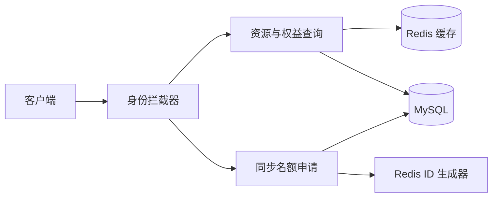

# FlashPass

### 限量预约与营销权益平台

面向品牌活动、热门场馆和会员权益的限量资源预约实践。围绕「资源查询 → 资格确认 → 名额申请」这条链路，整理身份识别、热点缓存与库存扣减的后端设计。

**Spring Boot · MyBatis-Plus · MySQL · Redis · Redisson**

[核心设计](#核心设计) · [快速启动](#快速启动) · [接口入口](#接口入口) · [工程记录](docs/engineering-notes.md) · [验证记录](docs/verification.md)

## 项目进度

| 业务环节 | 当前代码 |
| --- | --- |
| 身份识别 | 验证码登录、Redis Token、请求上下文与过期续期；兼容 Session |
| 资源检索 | 复用门店与权益查询，热点详情使用 Redis Cache Aside 和短期空值缓存 |
| 名额申请 | 同步事务内检查活动时间，使用 `stock > 0` 条件更新库存并创建记录 |
| 候补、超时回收、异步落库 | 路线图，尚未完成 |

当前是从既有业务工程向预约场景演进的后端版本。接口与表名保留 `shop` / `voucher` 的兼容映射，便于复用已有数据；详细说明见[业务映射与边界](docs/engineering-notes.md)。

## 核心设计

### 1. 将身份识别收敛到请求入口

登录后生成 Token，将精简用户信息保存到 Redis Hash；拦截器读取 `authorization` 请求头、恢复用户上下文并刷新有效期，请求结束清理 ThreadLocal。验证码仍使用开发环境的 Session 流程。

### 2. 用缓存承接重复资源查询

详情查询先读取 Redis，未命中再查询 MySQL；不存在的资源写入短期空值，更新资源后删除详情缓存。随机 TTL、互斥重建与逻辑过期尚未接入查询主链路。

### 3. 为预约链路保留明确的演进路径

当前同步路径使用数据库条件更新控制库存扣减，Redis ID 生成器分配记录 ID。已有重复申请检查尚不能保证并发幂等；后续需要唯一约束、Lua 原子预校验和幂等消费共同闭环。



## 快速启动

准备 JDK 17、Maven 3.9、MySQL 和 Redis。在空的开发数据库中导入 `src/main/resources/db/flashpass.sql`；脚本包含重建表语句，请使用专用开发库。

```sql
CREATE DATABASE flashpass CHARACTER SET utf8mb4;
```

```powershell
git clone https://github.com/spylent-1/flashpass.git flashpass
cd flashpass
# 用 MySQL 客户端将 src/main/resources/db/flashpass.sql 导入 flashpass
$env:DB_PASSWORD = "你的本地数据库密码"
$env:REDIS_HOST = "localhost"
$env:FLASHPASS_UPLOAD_DIR = "$PWD/uploads"
mvn spring-boot:run
```

默认端口 `8081`。`.env.example` 是变量参考，需要在终端中导出；Spring Boot 不会自动读取该文件。数据库默认使用 `flashpass`，已有库可以通过 `DB_URL` 指向原库。

开发验证码需要设置 `APP_LOG_LEVEL=debug` 后在本地日志查看；当前未接入短信服务，勿作为生产认证服务部署。

## 接口入口

| 接口 | 用途 |
| --- | --- |
| `POST /user/code?phone=...` | 生成开发验证码；客户端需保留 Session Cookie |
| `POST /user/login` | 提交 `phone`、`code`，获得 Token |
| `GET /user/me` | 查看当前用户，请求头使用 `authorization: <token>` |
| `GET /shop/{id}` | 查询资源详情及缓存 |
| `POST /voucher-order/seckill/{id}` | 同步名额申请的兼容接口 |

## 工程结构

```text
src/main/java/io/github/spylent1/flashpass/
  controller/   HTTP 接口
  service/      登录、资源查询与申请业务
  mapper/       数据访问
  config/       MVC、Redis 客户端等配置
  utils/        身份上下文、ID 与缓存工具
src/main/resources/db/flashpass.sql
src/test/java/io/github/spylent1/flashpass/
docs/
```

## 验证与路线图

```bash
mvn verify
```

CI 使用 JDK 17 验证构建、Mapper XML 绑定与单元测试；[验证记录](docs/verification.md)区分自动化检查与依赖真实中间件的验证。

- [ ] Redis + Lua 原子完成资格校验、库存预扣与重复申请控制。
- [ ] RabbitMQ 异步落库、幂等消费、失败补偿与一致性核对。
- [ ] ZSet 候补队列、取消释放、超时回收与补位状态流转。
- [ ] 提交固定环境、数据规模和脚本可复现的并发测试报告。

尚无可复核的压测报告，因此不展示缓存命中率、QPS 或延迟提升数字。
